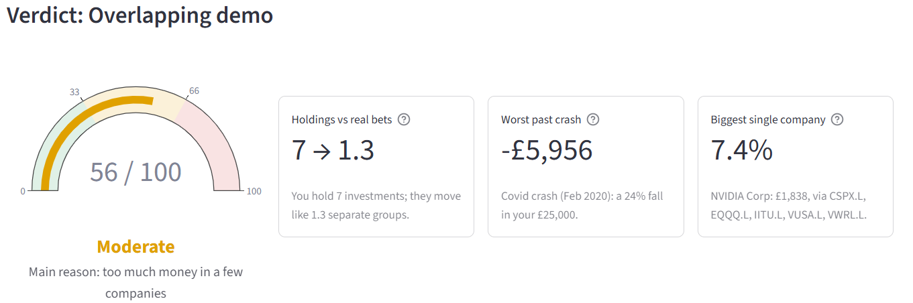
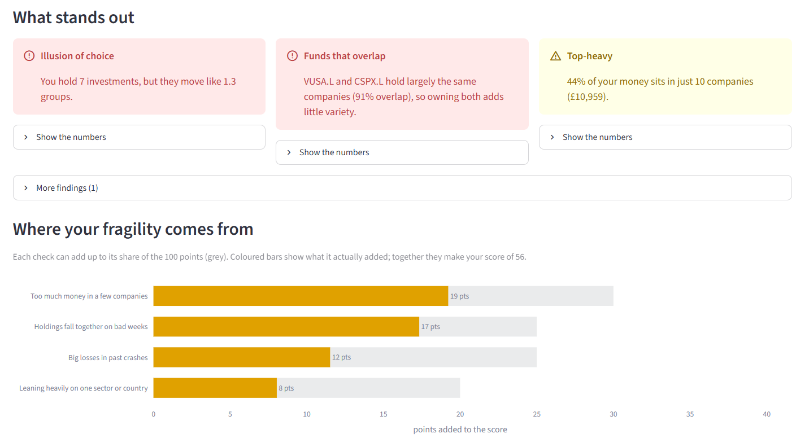
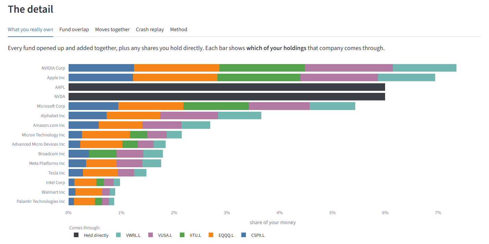
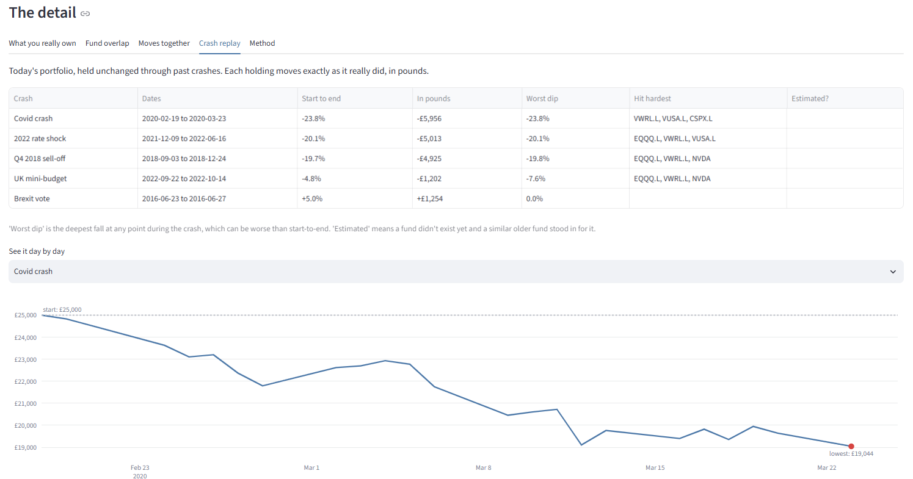
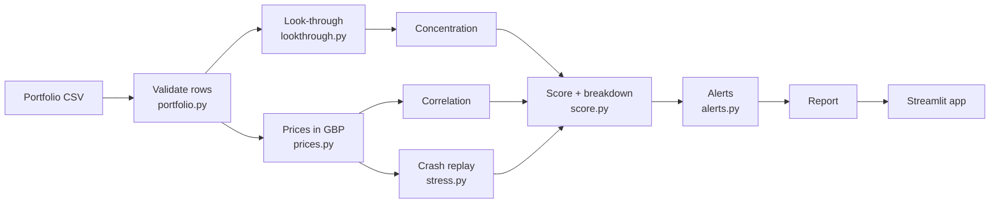

# Fragility Monitor

**Is your portfolio as diversified as you think?** Upload your ISA holdings and see what you really own, what falls together, and what past crashes would have cost, as one explainable score.


**[Try the live app →](https://fragility-monitor.streamlit.app/)** &nbsp;·&nbsp; Built with Python, pandas and Streamlit &nbsp;·&nbsp; 168 automated tests

---

## The problem

Many UK investors hold a few funds and assume they are spread out. But funds overlap: a global tracker, an S&P 500 fund and a Nasdaq fund all hold the same handful of US tech giants, and an investing app shows them as separate holdings, so the overlap stays hidden.

The overlapping demo portfolio holds **7 investments worth £25,000**. Underneath, **[FILL: Apple/NVIDIA] alone is [FILL: x]% of the money**, reached through [FILL: n] different routes; its holdings move like **[FILL: x.x] separate groups** on bad market weeks; and held through the 2020 Covid crash it would have lost **[FILL: £x,xxx] ([FILL: x]%)**. It scores **[FILL: xx]/100: Fragile**.

## What it shows

| | |
|---|---|
|  | **Verdict.** A 0–100 fragility score, its band, and three headline numbers: holdings vs real bets, worst past crash in £, biggest single company. |
|  | **What stands out.** Plain-English alerts from simple, traceable rules, plus a breakdown of where every point of the score comes from. |
|  | **What you really own.** Every fund opened up and added together, each company split by the fund it comes through. |
|  | **Crash replay.** Today's portfolio held through real past crashes, day by day, in pounds. |

Three demo portfolios are built in (overlapping, naive, diversified), or upload a CSV, or type holdings in.

## How it works

The app answers five questions, each with its own module:

1. **What do I really own?** Look-through: open every fund and add up each company across all of them, plus shares held directly.
2. **How many separate bets do I have?** Concentration: top-10 share, sector and country tilt, and the effective number of bets (1 / HHI).
3. **Do my holdings fall together?** Correlation of weekly returns, measured on the weeks when the global market fell more than 2%.
4. **What would past crashes have cost?** Historical replay of today's portfolio through five real episodes (Covid 2020, the 2022 rate shock, Q4 2018, the 2022 mini-budget, the Brexit vote), plus two "what if tomorrow" shocks.
5. **So how fragile is it?** Four checks scored 0–100 on a straight line between a "calm" and an "alarm" level, combined into one weighted score.



Every number on the page comes from one `Report` object built by `pipeline.py`; the app itself only draws.

## Method and limitations

**Data.** Fund holdings come from each provider's published holdings files (Vanguard, iShares, Invesco, HSBC), snapshot dates shown in the app. Daily prices come from Yahoo Finance via `yfinance`, converted to pounds (pence-quoted London lines divided by 100, dollar lines converted at the daily rate). Full method notes: [docs/methodology.md](docs/methodology.md).

**Scoring.** Each check maps its measurement to 0–100 points between a calm and an alarm value; the thresholds were calibrated so five reference portfolios rank sensibly (overlapping > naive > 100% global tracker > diversified ≈ 60/40). See `scripts/calibrate.py` and `docs/calibration.csv`.

**Problems the real data threw up** (all found by `scripts/sanity_checks.py`, which compares results with facts from outside the app):

- **A one-day ×1.34 price spike** in two London-listed funds on 24 Oct 2025: Yahoo had recorded the dollar price for a single day. Unit tests can't catch this (the maths was right, the input was wrong), so prices now go through a spike filter.
- **Two S&P 500 funds overlapping only 59%** when each fund kept just its top 50 holdings. Keeping the top 500 brought the comparison close to the expected ~100%.
- **Four providers, four file formats and four ways to spell a company** ("NVIDIA CORP USD0.001", "NVIDIA Corp"): a cleaning step standardises columns, sectors, countries and names, with a reviewed list of manual matches.

**Limitations.**

- Each fund's top 500 holdings are named; the rest is treated as many small companies, so company, sector and overlap figures are minimums.
- Holdings are a snapshot; funds change slowly over time.
- Past crashes are not a forecast of the next one.
- Bond and gold funds are treated as one block each, not looked through.
- **This is an educational tool, not financial advice.** It describes risk; it doesn't tell anyone what to buy or sell.

## Run it locally

Requires [Anaconda](https://www.anaconda.com/) or Miniconda.

```bash
git clone https://github.com/pakhi-1411-2002/fragility-monitor.git
cd fragility-monitor
conda create -n fragility python=3.13 -y
conda activate fragility
pip install -r requirements.txt pytest
pip install -e .
streamlit run app/Home.py
```

The repo includes the reference data and a starter price cache, so the app runs straight away. To refresh prices: `python scripts/refresh_prices.py`.

**Tests and checks**

```bash
pytest                              # 168 unit and integration tests
python scripts/sanity_checks.py     # 10 checks against real-world facts
python scripts/calibrate.py         # score ranking on 5 reference portfolios
```

## Project structure

```
fragility-monitor/
├── app/                    Streamlit page (draws only, no maths)
│   ├── Home.py             page layout
│   ├── components.py       charts and cards
│   └── data.py             cached loading
├── src/fragility/          the engine: plain functions, DataFrames in and out
│   ├── portfolio.py        CSV validation (pydantic)
│   ├── prices.py           download, pence/FX to GBP, cleaning, cache
│   ├── lookthrough.py      fund -> company exposure, fund overlap
│   ├── concentration.py    HHI, effective bets, tilts
│   ├── correlation.py      normal and bad-week correlation, groups
│   ├── stress.py           crash replay, hypothetical shocks
│   ├── score.py            0-100 score with breakdown
│   ├── alerts.py           plain-English rules
│   ├── pipeline.py         run_analysis() -> Report
│   └── config.py           every threshold and setting
├── scripts/                build holdings, refresh prices, calibrate, sanity checks
├── data/reference/         fund list, cleaned holdings, crash dates
├── data/demo/              three demo portfolios
└── tests/                  pytest suite and broken-CSV fixtures
```

**Tech stack:** Python 3.13 · pandas · NumPy · SciPy (hierarchical clustering) · pydantic · yfinance · Plotly · Streamlit · pytest · ruff

## What I'd build next

- **Analyst view:** rank many client portfolios by fragility, with a Power BI report for drill-down.
- **Monthly holdings refresh** on a schedule, so snapshots never go stale.
- **"What if" mode:** see how the score changes if one holding is swapped for another.
- **Look-through for bond funds**, by issuer and duration.

---

*Not affiliated with any fund provider. Educational use only; not financial advice.*
